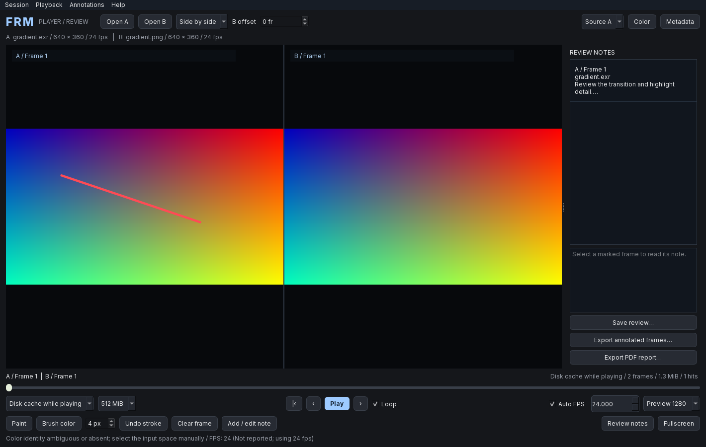

# FRM

**Player and review, together.** FRM is a portable, open-source desktop workspace for image sequences and movies, version comparison, frame painting and review notes.

FRM is made for artists, editors and post-production teams who want to drop a shot into a viewer, inspect frames and move on.

## Development transparency

FRM is a **vibe-coded project**, created by Luca Auletta with substantial AI assistance through OpenAI Codex. Product direction and feedback come from Luca; much of the code, documentation and automated testing is generated and iterated with AI assistance.

We disclose this openly so users can make an informed choice. Passing automated tests does not replace independent code review or validation in real production workflows. FRM is an experimental preview; community review, bug reports and contributions are welcome.



> **Version 0.3.1 is an early preview, not a validated mastering tool.** It implements real media decoding, ACES/OCIO viewing transforms, LUTs and temporary preview caching. Read the limitations below before using it for production decisions.

## Download and open

Download the package for your computer from [GitHub Releases](https://github.com/lucaauletta/frm/releases).

| Computer | Package | Start |
| --- | --- | --- |
| Windows x64 portable | `FRM-...-Windows-x64-Portable.exe` | Double-click the single file |
| Windows x64 installed | `FRM-...-Windows-x64-Setup.exe` | Run Setup |
| Linux x64 | `FRM-...-Linux-x64.tar.gz` | Extract and run `./FRM-Portable` |
| Mac Apple Silicon / Intel | Corresponding macOS ZIP | Extract and open FRM.app |

The Windows portable is **one EXE**, with no adjacent `_internal` folder or Python/codecs to install. Runtime libraries, licenses and application source are embedded. Each launch extracts its runtime into a private temporary directory, removed on normal exit. This is separate from media cache and makes startup slower. Forced termination may leave runtime files. Do not run the portable as administrator.

Windows Setup installs per user under `%LOCALAPPDATA%/Programs/FRM`, without administrator access, and adds a Start menu shortcut and uninstaller. Future installers use the same application identity and reuse the installation directory. Save your review and close FRM before upgrading. Portable copies remain independent. Uninstalling leaves saved reviews and exports intact.

Linux supports **Ubuntu 24.04 x64 or compatible newer glibc desktops (glibc 2.39+)**, not Alpine/musl or Linux ARM. It includes Python and media libraries; system graphics drivers and desktop libraries remain required. On Ubuntu: `sudo apt install libegl1 libopengl0 libxcb-cursor0 libxkbcommon-x11-0`. Extract using `tar -xzf FRM-...-Linux-x64.tar.gz`; run `./FRM-Portable`. If necessary, use `chmod +x FRM-Portable`. Temporary storage must allow execution and symbolic links. CI validates Linux using Qt offscreen; specific desktops/drivers require field testing.

Source-and-Notices ZIPs are optional companion downloads, not dependencies. Playback works offline. Runtime extraction and disk preview cache use writable operating-system temporary storage.

Early builds are unsigned. Windows SmartScreen or macOS Gatekeeper may ask you to approve opening the app. On macOS, use the normal **Privacy & Security → Open Anyway** flow for a download you trust; do not disable system security globally. macOS builds target macOS 14 or later; Windows builds target Windows 11 x64. Other versions are not validated.

## Start playing immediately

1. Drop a movie, one numbered sequence frame or a folder containing one sequence into FRM. **Open A** does the same. Drop two files to open an A/B comparison.
2. Press **Play** or **Space**. FRM reads the requested frames directly; it does not prepare the whole shot first.
3. Choose **RAM cache while playing** (default), **Disk cache while playing**, or **Direct / no cache**. The current frame is delivered before it is added to the optional cache.
4. Use **Color** for the selected source to inspect or override the viewing transform. **Metadata** shows the decoder-reported information and its interpretation.

The app never modifies your source media and contains no telemetry.

### Updates and publisher

Use **Help > Check for updates** to check published GitHub releases, including previews. **Check for updates at startup** defaults to on for Windows installed copies and off for portable copies. The preference is stored in your user profile. GitHub receives a normal HTTPS request (including your IP address), never media paths, images or notes. Failed automatic checks stay quiet; playback works offline.

A newer version offers to open the official release page. Run the new Windows **Setup** to upgrade; replace the EXE for portable Windows, or the app/binary for Mac/Linux. Downloads and installation are not automatic or silent.

Publisher/copyright metadata identifies **Luca Auletta** and **https://github.com/lucaauletta/frm**. These builds are unsigned: author metadata is not a digital signature and does not remove Windows SmartScreen/Unknown Publisher warnings. There is no signed automatic update channel yet.

## Compare two versions

Open a source in **A**, then another in **B**. Select **View A**, **View B**, **Side by side**, or **Wipe A / B**. In wipe mode, drag across the viewer with Paint disabled to move the dividing line.

**B offset** is a signed offset measured in decoded frames:

```text
B frame index = A frame index + offset
```

If A's first matching image is its frame 1 and B's is its frame 11, enter **+10**. Enter **-10** if B starts ten frames later relative to A. Missing/out-of-range B positions are shown blank; FRM never freezes the first or last B frame to make it look synchronized. The timeline belongs to A, so extend/swap your source choice if the review must include B frames beyond A's duration.

Comparison is frame-for-frame at A's playback rate. When source rates differ, FRM displays a warning instead of silently resampling or claiming timecode synchronization. Both versions retain separate metadata, viewing color and cached pixels. Comparison waits for the matching A/B pair before presenting it.

## Paint, write notes and save a review

- Pause on a frame, enable **Paint**, choose a brush color and width, then draw on the image. In side-by-side or wipe mode, click the visible part of the version you want to mark.
- **Undo stroke** removes the last stroke on the selected source/frame. **Clear frame** removes that frame's paint and note.
- Select **Source A** or **Source B**, then **Add / edit note** to write a text note for that visible frame.
- **Review notes** shows/hides the note panel. Select an entry to revisit its source frame.
- **Save review** writes a `.frmreview` document. It contains paint, text, compressed preview snapshots, source references, color settings and comparison alignment. Open it with **Session → Open review**.
- Original media is referenced, not copied into the review document. Move the media and those references can break; the saved annotated snapshots can still be exported. Opening media does not erase earlier notes. Use **Session → New review** to start a separate document.

Notes are attached to a source path and decoded frame index, not the screen position or comparison offset. Renaming/replacing a file at the same path is not tracked by a content hash. Save separate review documents for different deliveries. Review snapshots are capped at 256 MiB of compressed data per document; this memory is separate from playback cache.

### Export every annotated frame

Use **Export annotated frames** and choose PNG or JPG. FRM creates a new folder, exports every painted or text-noted frame, and includes `notes.json` with text and source/frame context. Existing exports are not overwritten.

Use **Export PDF report** for a report with annotated images, source/frame references, viewing context and written notes. Long notes continue onto additional pages. Report replacement is atomic: a failed export does not overwrite a previous report.

Exports use the preview image captured when that frame was first annotated, with normalized paint drawn onto it. They are **display-referred review images at preview resolution**, not original-resolution source exports. Changing a LUT later does not silently recolor a previously captured note. Clear/re-annotate the frame if a new viewing transform should be captured.

**Saved reviews, PNG/JPG exports and PDF reports are permanent documents. They are never deleted with playback cache.** Unsaved paint/text prompts you to save when closing the app or starting another review.

## Supported media

| Media | Decoder | Notes |
| --- | --- | --- |
| DPX | OpenImageIO | RGB image sequences; choose the correct linear/log input space yourself |
| EXR | OpenImageIO | Flat RGB, including half/float; top-level R/G/B channels only |
| TIFF / TIF | OpenImageIO | First image/subimage only |
| JPEG / JPG, PNG | OpenImageIO | RGB or grayscale; alpha is ignored |
| MOV: ProRes, DNxHD / DNxHR, H.264, H.265 | FFmpeg through PyAV | Decoder availability depends on bundled FFmpeg; see validation below |
| MP4: H.264, H.265 | FFmpeg through PyAV | Video preview only; no audio in this version |

Numbered sequences such as `shot.1001.exr` are found automatically in the same folder. Matching requires the same prefix, extension and numeric padding. Frames sort numerically. Missing frame numbers are reported when caching completes and are **collapsed**, not replaced with black frames. Open one frame when a folder contains multiple sequences. Unnumbered images open as stills.

Synthetic tests exercise DPX, EXR, TIFF, JPEG, PNG, MOV/ProRes, MOV/DNxHD, MOV/DNxHR HQX (10-bit), MP4/H.264 and MP4/H.265. This does not constitute validation of every camera profile, bit depth, chroma mode, container or damaged file.

## Metadata, frame rate and viewing color

**Metadata** displays all attributes exposed by OpenImageIO for the first image of a sequence and the first video stream/container exposed by FFmpeg. This includes image chromaticities, color-space strings, ICC-related fields when available, DPX/EXR attributes, video primaries, transfer characteristic, matrix coefficients, range, pixel format, average/base/guessed FPS, time base and stream/container tags. Binary blobs are summarized instead of dumped into the interface.

This is not a promise that every vendor's proprietary metadata is available. The app does not scan every frame for metadata changes, and a decoder may supply a convention/default rather than an explicit embedded tag. Absent, unsupported or conflicting color information is identified visibly.

- **Auto FPS** uses the exact rational source rate when available, e.g. `24000/1001`, even though the spin box displays three decimals. Images without an FPS field default to 24 with a visible fallback label. Editing FPS enables a manual override.
- Explicit recognized OCIO color names, ACES image flags and linear encoding with recognized chromaticities identify the input color space. EXR primaries without an encoding tag use the conventional linear EXR interpretation and explicitly label that assumption. An EXR without primaries/identity remains unknown; it is not automatically called ACEScg.
- Recognized scene-linear sources receive the built-in **ACES 2.0 Studio** display transform. Display-ready images/video retain bypass by default; known input identity is still selected for inspection. PQ/HLG tags are reported as HDR and require a deliberate viewing choice; there is no HDR display output.
- Bare `linear`, incomplete camera-log names, unsupported tags and conflicting identities do not cause a guessed transform. Set the actual input space using **Color**.
- Movie YUV-to-RGB conversion is performed by FFmpeg. Reading range/matrix tags does not add a manual YUV override or guarantee that malformed tags are correct.

The selected source's viewing pipeline is:

```text
Decoded float RGB → exposure offset → OCIO display/view → optional viewing LUT → 8-bit preview
```

Custom `.ocio` configurations and OCIO-readable LUTs (`.cube`, `.3dl`, `.spi1d`, `.spi3d`, `.csp`) are supported. Keep external files referenced by custom configs available. LUTs run **after** the display transform; for a camera-log-to-display LUT, disable that transform and ensure its input matches your material. Exposure multiplies source RGB; physical stops are meaningful on linear input.

Negative and above-one image values reach OCIO. Final display values are clipped to 0–1 and quantized to 8-bit RGB. Changing color, cache mode, cache budget or preview size discards the affected playback cache and reopens the media at the current position. Review notes remain available.

**No HDR/10-bit output, system ICC monitor correction, calibrated video output, alpha compositing, pixel inspector or scopes are implemented.** This is a review preview, not a reference for final color approval. Deep/volume EXR, multipart/layer selection, multiview and EXR display-window placement are not supported.

## Direct reading, RAM and disk cache

All modes decode only requested frames on background workers. There is one active request and one replaceable pending request per source, so rapid scrubbing cannot enqueue an entire shot. The default preview width is 1280; 1920 and 3840 are available. Small sources are not enlarged in the cache.

| Mode | Behavior | Cleanup |
| --- | --- | --- |
| **Direct / no cache** | Reads each requested frame from the source; retains only transient decoder/display buffers | No FRM playback-cache files are created |
| **RAM cache while playing** | Reuses recently viewed display-ready frames in memory | Cleared on source replacement, cache change and close; process exit releases memory |
| **Disk cache while playing** | Stores recently viewed display-ready frames in a private temporary folder | Folder deleted on normal close/replacement after the writer stops |

The selectable **256 MiB / 512 MiB / 1 GiB / 2 GiB** limit is the combined A/B cache budget. With two sources, each receives half. This limits cached RGB data, not total process memory: native decoders, float conversion buffers, displayed images and review snapshots need additional memory. Frames larger than the budget are simply displayed without storage.

Both caches evict least-recently-used frames when full. Playback does not stop merely because the cache budget is reached. Disk caching also reserves 512 MiB free space; storage failures disable caching and report that direct reading continues. Cache statistics show retained frames, bytes and reuse hits.

FRM does not write RAM-cache frames to disk. The operating system may independently page process memory. Disk caches use unique `frm-session-*` directories in the OS temporary directory; the app removes only the folders it created. **A crash, forced process termination or power loss can leave disk-cache files.** After closing all FRM instances, abandoned `frm-session-*` directories can be removed manually. No unconditional crash-cleanup guarantee is made. A normal-close deletion failure is reported instead of claiming success.

Playback follows a monotonic clock and may skip frames if decoding is slower than the selected rate. Cache fills with the frames actually requested, not with an eager full-shot preload. Backward **uncached movie seeks restart decoding from the beginning** to preserve exact decoded frame indices, so seeking in long movies can be slow. Cached frames avoid that work. Unknown movie frame counts grow during decoding and become exact at EOF. VFR timestamps, embedded timecode playback and audio synchronization are not preserved; movies use average FPS.

Realtime performance depends on media, storage, preview size and hardware. Decoding and OCIO currently run on the CPU. There is no hardware video decoding or GPU display-transform path yet.

## Controls

| Action | Control |
| --- | --- |
| Open A / B | Open A / Ctrl+O; Open B / Ctrl+Shift+O |
| Play / pause | Space |
| Previous / next frame | Left / Right |
| First frame | Home |
| Seek | Timeline |
| Repeat the shot | Loop |
| Fullscreen | F / Fullscreen button |
| Leave fullscreen | Escape |
| Close media and clear cache | Ctrl+W |
| Save / open review | Ctrl+S / Ctrl+R |

## Build from source

For contributors; end users should use portable packages. Use **Python 3.13** and a native Windows or macOS environment. PyInstaller does not cross-compile between these operating systems.

Windows PowerShell:

```powershell
git clone https://github.com/lucaauletta/frm.git
cd frm
py -3.13 -m venv .venv
.\.venv\Scripts\python.exe -m pip install -e ".[dev]"
.\.venv\Scripts\python.exe run_frm.py
.\.venv\Scripts\python.exe -m pytest -q
.\.venv\Scripts\python.exe scripts/build.py
```

macOS Terminal:

```bash
git clone https://github.com/lucaauletta/frm.git
cd frm
python3.13 -m venv .venv
.venv/bin/python -m pip install -e '.[dev]'
.venv/bin/python run_frm.py
.venv/bin/python -m pytest -q
.venv/bin/python scripts/build.py
```

Output: `dist/FRM-Portable.exe` on Windows, `dist/FRM-Portable` on Linux, `dist/FRM.app` on macOS. Compile `packaging/windows.iss` with Inno Setup 6 for Windows Setup. Build each OS/architecture natively. Dependencies are pinned in `pyproject.toml`; builds embed dependency versions, third-party notices and corresponding FRM source. Companion source/notices ZIPs are written to `artifacts`.

## Project structure

```text
frm/app.py       App startup, styling and viewing-color dialog
frm/window.py    Player/review workspace and transport
frm/viewer.py    A/B canvas, wipe and painting gestures
frm/playback.py  On-demand decode workers and session lifecycle
frm/media.py     Sequence discovery and image/movie decoding
frm/metadata.py  Decoder metadata and conservative color interpretation
frm/color.py     OpenColorIO viewing pipeline
frm/cache.py     Bounded LRU RAM/disk caches
frm/review.py    Frame notes, saved reviews, image/PDF exports
tests/          Synthetic codec, color, cache and lifecycle tests
scripts/        Native portable build tooling
```

See [CONTRIBUTING.md](CONTRIBUTING.md) for development and release steps, [CHANGELOG.md](CHANGELOG.md) for version history and [THIRD_PARTY_NOTICES.md](THIRD_PARTY_NOTICES.md) for dependencies.

## Roadmap

Priorities are production-media validation, GPU display transforms, faster frame-accurate movie seeking, audio and VFR timing, more precise video color controls, EXR layers/display windows, signing/notarization and measured playback benchmarks. These are planned, **not implemented features**.

## License

FRM is licensed under **GNU GPL version 3 only (`GPL-3.0-only`)**. See [LICENSE](LICENSE).

You may use FRM commercially, study it, change it and share it. If you distribute FRM or a modified version, comply with the GPL, including providing corresponding source and retaining required notices. Using the app does not change the ownership or license of your footage, images or LUTs. Third-party libraries retain their respective licenses. There is no warranty.

Created for Luca Auletta and the open-source post-production community.
